# Switches on a TV

Every key a theme can set (the Keys table in [`themes/README.md`](../themes/README.md)) gets a
screenshot of what it does on a real TV. This table is where they are listed: the repo and
[cleanyour.tv/addons#switches](https://cleanyour.tv/addons#switches) both show them from here.

## Adding a key

A new key needs a screenshot. Put it in `docs/switches/<key>.jpg` (an existing screenshot in the
repo that shows the key at work also counts) and add a row below:

- From a real TV, with the key set, as a JPEG or PNG, 16:9 (1280×720 is plenty), under 300 KB.
- Show where the key changes something you can see. For a key that maps a remote button, show the
  screen the button opens; for one that changes behaviour only, show the setting's effect, such as
  the panel, the menu or the app that comes up.
- Blur anything personal: Wi-Fi names, people, addresses.

`tests/test_switches.py` checks that every key has a row here with an image that exists and fits
the rules. Keys from before this rule are on its wanted list; a screenshot for one of them is welcome.

## Screenshots

| Key | Screenshot |
|---|---|
| `columns` |  |
| `glass_style` |  |
| `sky_intensity` |  |
| `wallpaper_rotation_minutes` |  |
| `festival` |  |
| `settings_key_panel` |  |
| `home_idle_clock_minutes` |  |
| `gamepad_passthrough` |  |
| `consume_volume_keys` |  |
| `wifi_status_warnings` |  |
| `top_bar_apps` |  |
| `show_greeting` |  |
| `header_white` |  |
| `clock_wallpaper` |  |
| `clock_wallpaper_dim` |  |
| `clock_glow` |  |
| `clock_slideshow_minutes` |  |
| `open_on_start_choice` |  |
| `single_row` |  |
| `dock_band_all` |  |
| `uniform_tiles` |  |
| `home_hook` | Fire TV Stick 4K Max (Fire OS 8.1.8.5): the launcher's Home a moment after the remote's HOME button, which Fire OS had routed to Amazon's home screen; HomeHookService covered it and started this launcher over it | 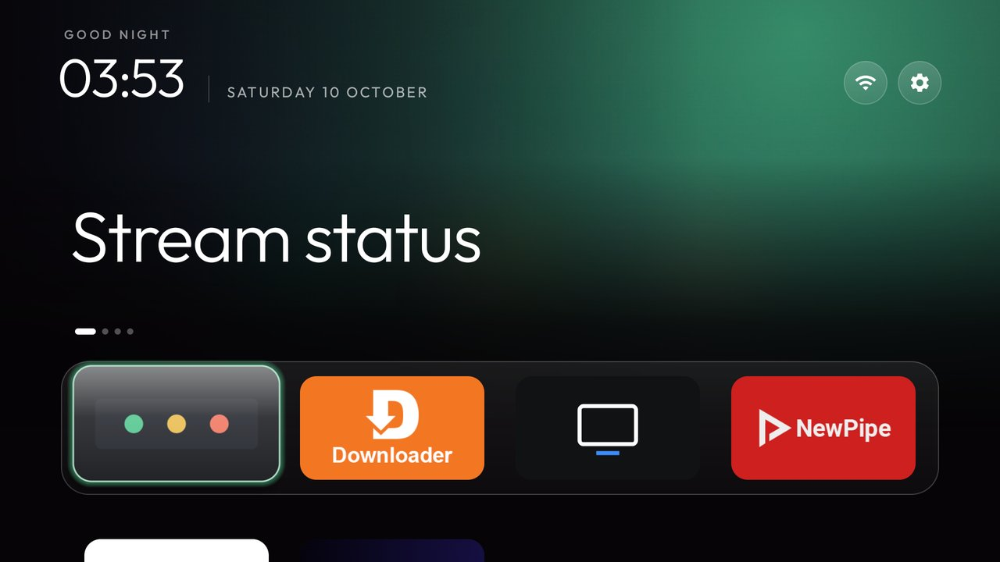 |
| `settings_menu_on_click` | Fire TV Stick 4K Max: OK on the Settings pill drops the launcher's menu, TV settings as its second row | 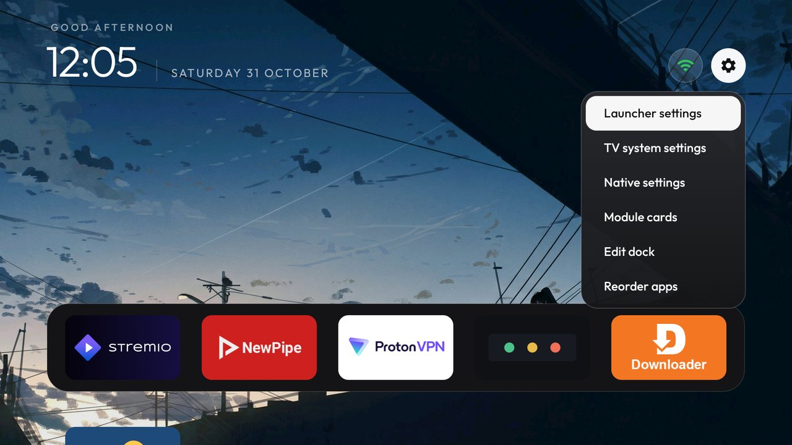 |
| `weather_provider` | Fire TV Stick 4K Max with the weather add-on installed: its "12° · Cloudy" line under the date, read from the add-on's content provider | 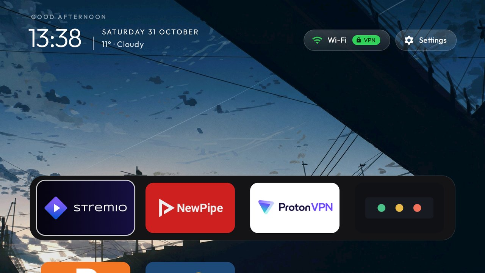 |
| `news_provider` | Fire TV Stick 4K Max with the news add-on installed: one BBC headline under the clock, the next every 20 seconds | 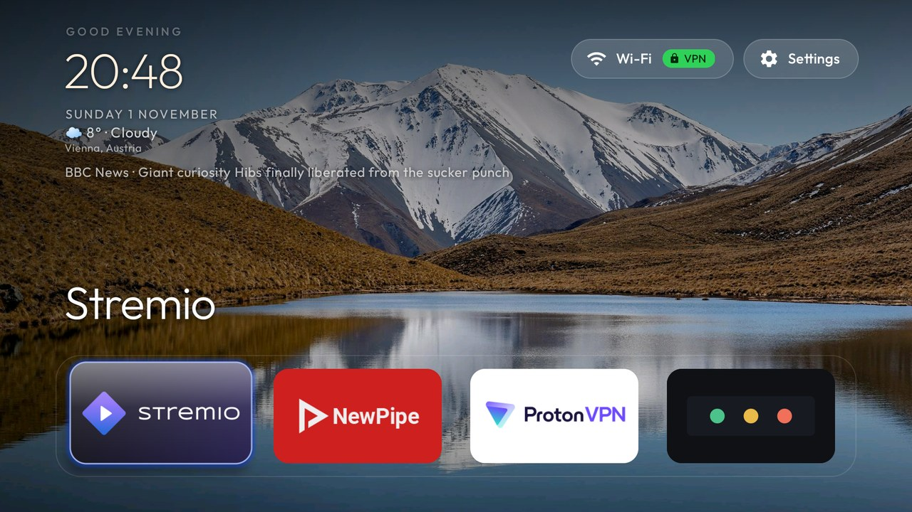 |
| `news_card` | Fire TV Stick 4K Max with the news add-on: the story picture with the source and headline beside it under the clock | 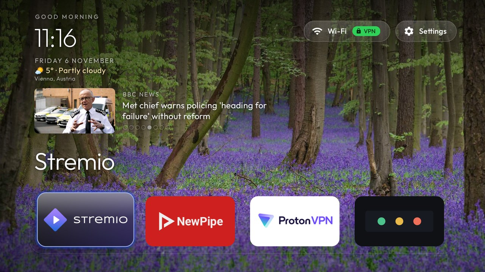 |
| `news_seconds` | Fire TV Stick 4K Max: the same story card, the next story every 10 seconds instead of 20 |  |
| `news_stories` | Fire TV Stick 4K Max: the story card cycling six stories, six dots |  |
| `news_position` | Fire TV Stick 4K Max: the story card under the Wi-Fi and Settings pills instead of the clock | 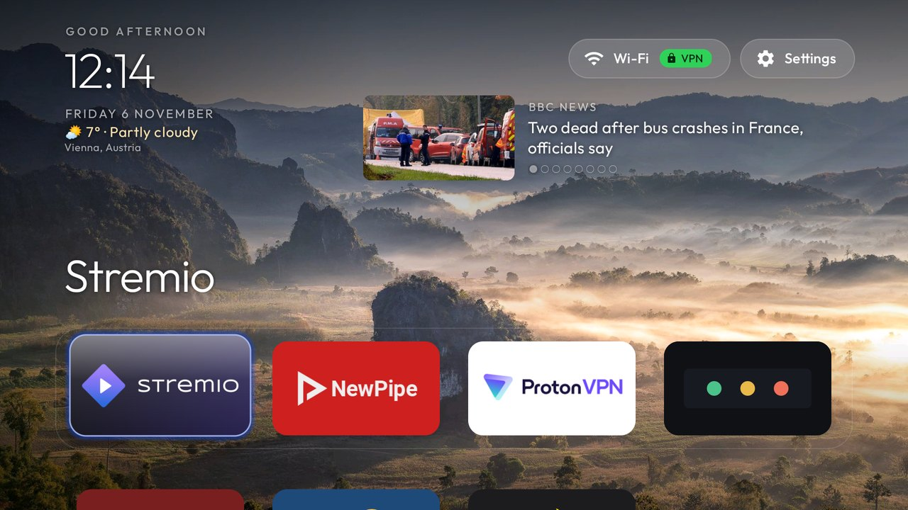 |
| `wallpaper_motion` | Fire TV Stick 4K Max: the Sweden picture drawn a few percent in, ready to slide against the focused tile | 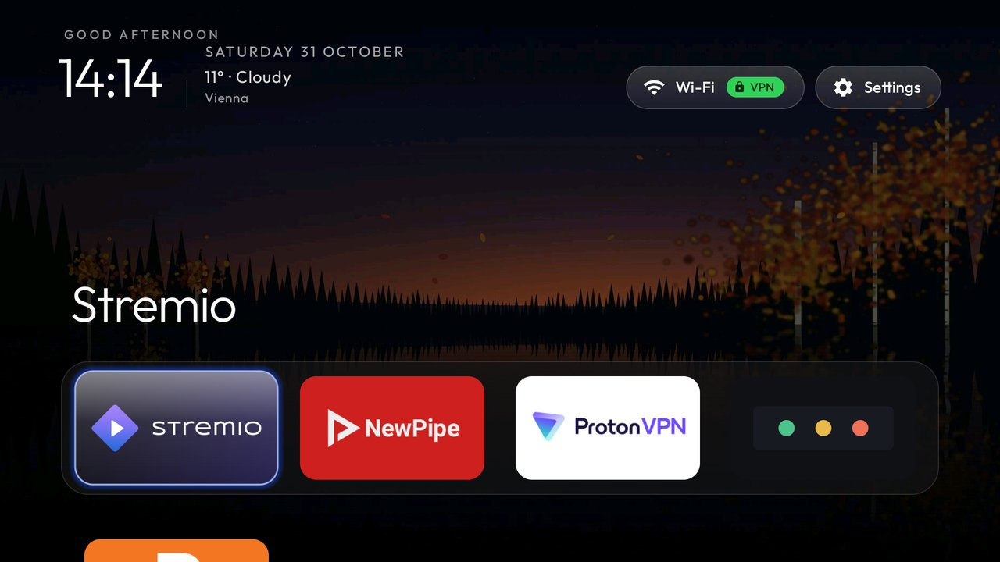 |
| `tile_shape` | Fire TV Stick 4K Max: `pill` tiles, the dock band and focus glass rounded to match | 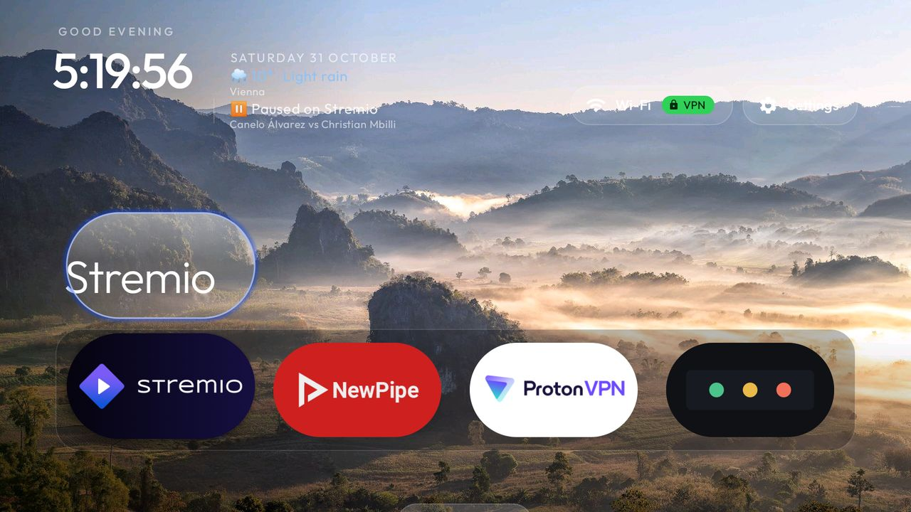 |
| `now_playing` | Fire TV Stick 4K Max: "▶ Playing on Stremio" with the title under the weather line while Stremio plays behind Home | 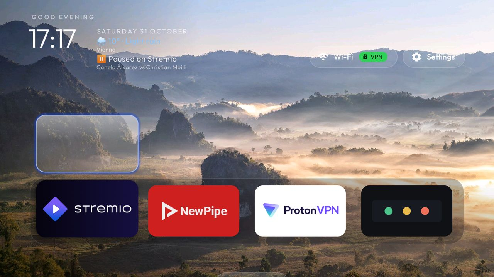 |
| `notification_line` | Fire TV Stick 4K Max: the latest notification's title under the now-playing line for a minute |  |
| `now_playing_card` | Fire TV Stick 4K Max: the paused app's tile with the film's artwork and its title | 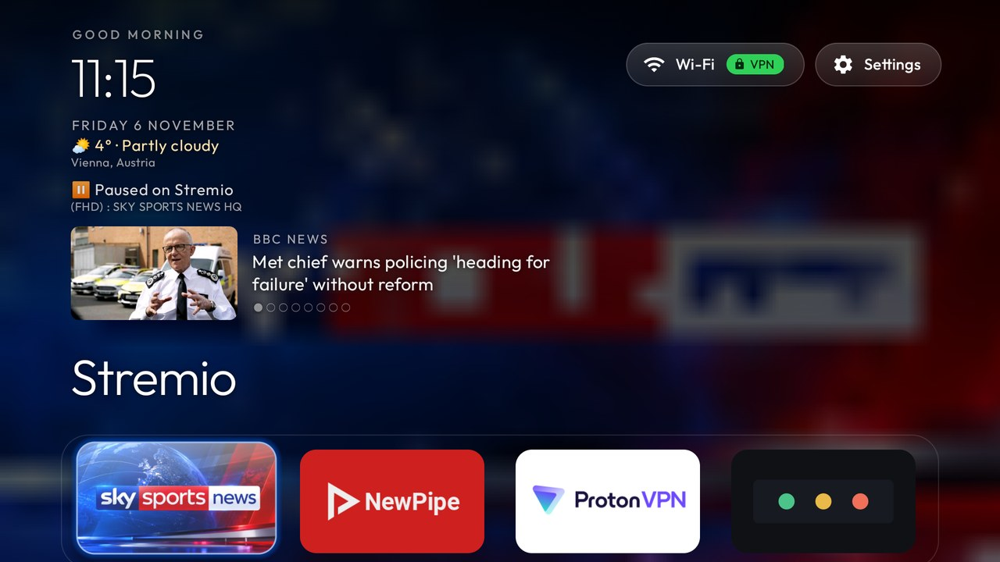 |
| `now_playing_art` | Fire TV Stick 4K Max: the paused film's artwork, soft and dark, behind Home |  |
| `header_scrim` | Fire TV Stick 4K Max: the top of the Ruska sky darkened behind the clock and the lines under it | 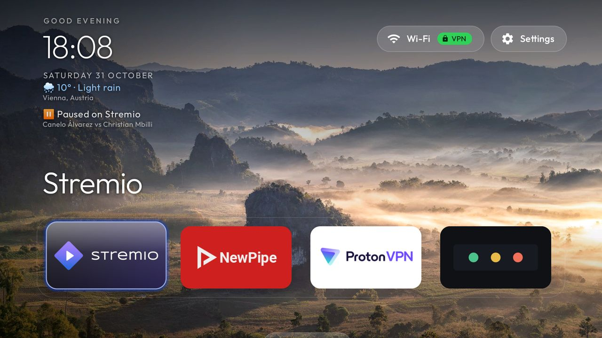 |
| `header_mood` | Fire TV Stick 4K Max: the weather line in the condition's tint (rain, cool blue) under the clock | 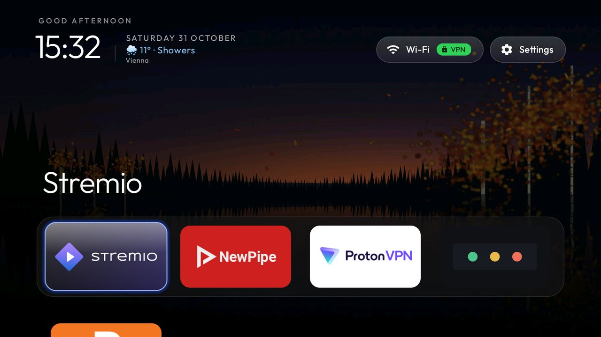 |
